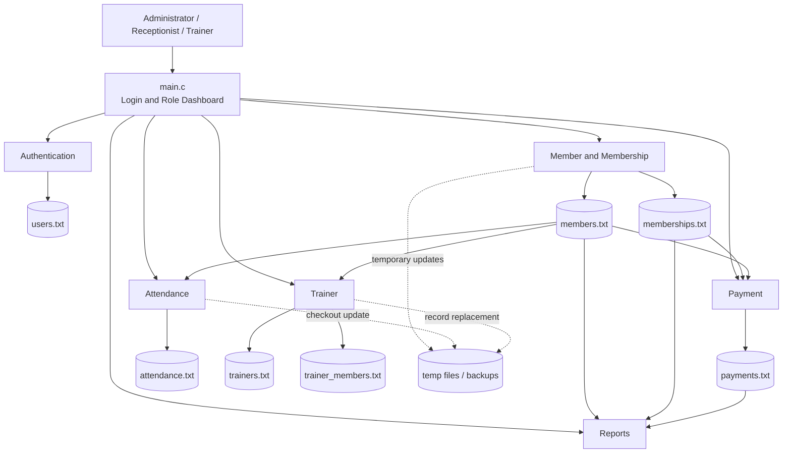

# AuraFlex Gym Management System

## Declaration

We declare that this report and the AuraFlex Gym Management System implementation are the original work of our group, except where external sources are explicitly acknowledged. The source code, design decisions, test data, and documentation were produced for this project. External documentation was consulted only to understand standard C language, library, and file-handling features.

## Acknowledgement

We acknowledge the guidance and feedback provided by our lecturer and instructors during the requirements, design, implementation, and testing stages. We also acknowledge the use of standard C library documentation and compiler documentation when resolving technical questions about console input, file processing, date/time handling, and string validation.

## Abstract

AuraFlex is a menu-driven gym management system developed in the C programming language to address the difficulties of managing gym members, memberships, payments, attendance, trainers, and operational reports manually. The system provides a role-based console interface for administrators, receptionists, and trainers. Users authenticate against a file-based user store, after which the available dashboard operations are selected according to their role.

The solution is organized into five main report-level components: access, member and membership management; payment management; attendance management; trainer management; and reporting. The implementation uses modular C source and header files, structures for record modelling, helper functions for validation, and text files for persistent storage. Separate files store users, members, memberships, payments, attendance records, trainers, and trainer-member assignments. Temporary files are used when records must be updated or removed safely.

Important features include masked password entry, limited login attempts, duplicate-ID prevention, member status control, membership assignment, shared membership payment processing, automatic payment and attendance ID generation, date and time recording, check-in/check-out control, trainer-member assignment, payment totals, expired membership detection, and daily attendance summaries. Input and file-opening errors are reported to the user rather than being silently ignored.

The completed system demonstrates how a small gym can centralize routine operations using a modular C application without requiring a database server. Testing focused on individual menus, record validation, file persistence, role-based navigation, and integration between membership and payment processing. The main limitations are the use of plain-text storage, limited reporting and search criteria, terminal-only interaction, and platform-specific console password input. These limitations provide clear opportunities for future improvements such as database storage, stronger password protection, richer reports, and a cross-platform graphical interface.

## Table of Contents

1. [Introduction](#1-introduction)
   1. [Background and Problem Description](#11-background-and-problem-description)
   2. [Project Aim and Objectives](#12-project-aim-and-objectives)
   3. [Scope of the System](#13-scope-of-the-system)
   4. [Development Environment](#14-development-environment)
2. [Requirement Summary](#2-requirement-summary)
   1. [Users and Main Operations](#21-users-and-main-operations)
   2. [Functional Components](#22-functional-components)
   3. [Major Validation](#23-major-validation)
3. [System Design and Architecture](#3-system-design-and-architecture)
   1. [Overall System Architecture](#31-overall-system-architecture)
   2. [Menu Structure / Navigation](#32-menu-structure--navigation)
4. [Methodology](#4-methodology)
   1. [Development Approach](#41-development-approach)
   2. [Programming Techniques Used](#42-programming-techniques-used)
   3. [Integration Process](#43-integration-process)
5. [Implementation](#5-implementation)
   1. [Access, Member and Membership Management](#51-component-1--access-member-and-membership-management)
   2. [Payment Management](#52-component-2--payment-management)
   3. [Attendance Management](#53-component-3--attendance-management)
   4. [Trainer Management](#54-component-4--trainer-management)
   5. [Reports](#55-component-5--reports)
6. [Testing and Results](#6-testing-and-results)
7. [Problems Faced During Development](#7-problems-faced-during-development)
8. [Conclusion and Future Improvements](#8-conclusion-and-future-improvements)
9. [References](#9-references)
10. [Appendices](#10-appendices)

# 1. Introduction

## 1.1 Background and Problem Description

Gyms manage many related activities at the same time: registering members, tracking membership periods, collecting fees, recording attendance, allocating trainers, and producing operational summaries. When these activities are handled using notebooks or disconnected files, staff may create duplicate records, lose payment information, miss membership expiry dates, or record attendance inaccurately. Manual processing also makes it difficult to restrict operations according to staff responsibilities.

AuraFlex addresses this problem with a centralized terminal application. The system stores operational records in structured text files and provides menus for the main gym activities. A computerized solution improves consistency by validating identifiers, checking member status, generating record IDs, reusing common functions, and presenting summaries from stored records.

## 1.2 Project Aim and Objectives

The aim of the project is to develop a modular C-based gym management system that supports reliable day-to-day gym administration.

The objectives are to:

- Authenticate users and provide role-based access.
- Register, search, update, and manage member records.
- Assign and display memberships and membership fees.
- Record and search payment history.
- Track member check-ins and check-outs.
- Manage trainers and trainer-member assignments.
- Generate membership, payment, attendance, and system summary reports.
- Validate user input and protect stored records during updates.

## 1.3 Scope of the System

The system covers:

- Administrator, receptionist, and trainer roles.
- User login with active-status checking.
- Member registration and status management.
- Membership assignment and payment recording.
- Attendance check-in, check-out, history, and daily summaries.
- Trainer registration, search, update, status changes, and member assignment.
- Member, membership, expired membership, payment, and summary reports.
- Persistent storage using text files.

The system does not currently include online payments, a database server, email or SMS notifications, biometric attendance, a graphical interface, networked multi-user access, advanced audit reporting, or comprehensive role-specific permissions for every operation. Text-file fields are whitespace-separated, so names and plan descriptions are effectively limited to one word unless underscores are used.

## 1.4 Development Environment

| Category | Description |
|---|---|
| Programming Language | C |
| Operating Environment | Terminal/command-line environment; the authentication module uses Windows console input through `conio.h` |
| Interface | Menu-driven text interface with formatted console tables |
| Data Storage | Plain-text files in the `data/` directory |
| Compiler | A C compiler such as GCC, Clang, or a compatible IDE compiler |

# 2. Requirement Summary

The finalized requirements describe a small gym system with authenticated access, operational record management, validation, persistent storage, and summary output. The implementation is divided into modules so that each major requirement can be developed and tested independently.

## 2.1 Users and Main Operations

### Administrator

- Manage members, memberships, trainers, payments, and attendance.
- View system reports and summaries.
- Access the complete administrative dashboard.

### Receptionist

- Register and view members.
- Manage memberships.
- Record payments.
- Record attendance.

### Trainer

- View assigned members.
- Assign members to trainers.
- Remove member assignments.

## 2.2 Functional Components

The implemented functional areas are:

1. Authentication and role-based dashboard access.
2. Member and membership management.
3. Payment management.
4. Attendance management.
5. Trainer management.
6. Reports and summaries.

## 2.3 Major Validation

The system validates:

- User credentials and active user status.
- Maximum login attempts.
- Duplicate member, membership, trainer, payment, and attendance identifiers.
- Existing and active member IDs.
- Positive payment and membership amounts.
- Payment dates in `YYYY-MM-DD` format.
- Accepted payment methods: `CASH`, `CARD`, and `ONLINE`.
- Duplicate check-ins on the same day.
- Open check-in records before check-out.
- Active trainer status before member assignment.
- Numeric menu input and invalid menu selections.
- File opening, writing, temporary-file, and replacement errors.

# 3. System Design and Architecture

## 3.1 Overall System Architecture

The system follows a modular, file-based architecture. `main.c` is the application entry point and coordinates authentication and dashboard navigation. Header files expose public module functions, while source files contain the implementation. Data files provide persistent storage.



### Data flow examples

- Login reads `users.txt`, returns the authenticated role, and opens the correct dashboard.
- Membership assignment verifies `members.txt`, records the membership, and calls the payment module.
- Attendance verifies `members.txt` before writing to `attendance.txt`.
- Reports read members, memberships, and payments to calculate totals and status summaries.
- Trainer assignment verifies both `trainers.txt` and `members.txt` before writing to `trainer_members.txt`.

## 3.2 Menu Structure / Navigation

```text
Login
├── Administrator Dashboard
│   ├── Member Management
│   ├── Membership Plans / Membership Management
│   ├── Trainer Management
│   ├── Payment Management
│   ├── Attendance Management
│   ├── Reports
│   └── Logout
├── Receptionist Dashboard
│   ├── Register Member
│   ├── Manage Membership
│   ├── Record Payment
│   ├── Record Attendance
│   ├── View Members
│   └── Logout
└── Trainer Dashboard
    ├── View Assigned Members
    ├── Assign Member
    ├── Remove Member
    └── Logout
```

Important submenus include:

```text
Payment Management
├── Record Payment
├── Search Payment History
├── View All Payments
├── Calculate Total Payments
└── Return

Attendance Management
├── Record Check-In
├── Record Check-Out
├── Search Attendance by Member ID
├── View Attendance History
├── Daily Attendance Summary
└── Return

Reports
├── Member Report
├── Membership Report
├── Expired Membership Report
├── Payment Report
├── Summary Report
└── Return
```

# 4. Methodology

## 4.1 Development Approach

The group followed a modular development approach. Requirements were first divided according to the major gym operations. Each contributor implemented one or more related modules, including its header declarations, source implementation, and relevant data files. Functions were developed around small record structures and file helpers so that the modules could be tested independently.

After individual development, modules were connected through `main.c` and shared headers. Integration focused on role-based navigation, member verification, membership payment processing, attendance validation, trainer assignments, and reports that consume data from several modules. Testing used valid and invalid menu inputs, existing and non-existing identifiers, status changes, file operations, and cross-component workflows.

## 4.2 Programming Techniques Used

The implementation uses:

- **Procedural programming:** Operations are represented by focused C functions.
- **Modular programming:** Public interfaces are declared in `.h` files and implementations are separated into `.c` files.
- **Structures:** Records such as `User`, `Member`, `Membership`, `Payment`, `Attendance`, and trainer records group related fields.
- **File processing:** `fopen`, `fscanf`, `fprintf`, `fgets`, `rename`, and `remove` provide persistent text-file storage.
- **Validation helpers:** Reusable functions check identifiers, status, dates, amounts, and menu input.
- **Sentinel values:** An open attendance record uses `-` as its check-out value.
- **Temporary-file replacement:** Updates and deletions rewrite records through a temporary file.
- **String and date processing:** `strcmp`, `strlen`, `strcpy`, `sscanf`, `strftime`, and `time` support validation and reporting.
- **Role-based control flow:** The authenticated role controls which dashboard and operations are displayed.

Example of the shared membership-payment integration:

```c
if (!processMembershipPayment(m.memberId, m.fee)) {
    printf("Membership assignment cancelled because payment failed.\n");
    return;
}
```

## 4.3 Integration Process

Integration was performed through public function declarations in headers. `main.c` calls the top-level menus, while modules call shared functions where a requirement crosses component boundaries. The most important integration points are:

- `login()` returns a populated `User` structure to `main.c`.
- `membership.c` calls `processMembershipPayment()` in `payment.c`.
- `payment.c` checks active members using `members.txt`.
- `attendance.c` checks active members before check-in and check-out.
- `trainer.c` checks members before creating trainer assignments.
- `reports.c` reads member, membership, and payment files to produce summaries.

# 5. Implementation

## 5.1 Component 1 - Access, Member and Membership Management

### Authentication

The authentication module reads user records from `data/users.txt`, compares the supplied username and password, and accepts only active users. It allows three attempts and masks the password during input. The authenticated `User` record is passed to the main dashboard so that role-specific navigation can be selected.

### Member management

Member management stores a member ID, name, phone, email, and status. It supports registration, viewing, searching, updating, freezing, and unfreezing. Duplicate IDs are rejected, and temporary-file processing is used for record updates.

### Membership management

Membership management stores a membership ID, member ID, plan name, start date, end date, fee, and status. It verifies that the member exists and that the membership ID is not already used. New memberships are marked active. A membership assignment also invokes the payment component so the fee is recorded.

Main files:

- `src/auth/auth.c`, `include/auth.h`
- `src/member/member.c`, `include/member.h`
- `src/membership/membership.c`, `include/membership.h`
- `data/users.txt`, `data/members.txt`, `data/memberships.txt`

## 5.2 Component 2 - Payment Management

The payment module stores payment ID, member ID, amount, date, and method. It supports normal payment recording, membership payments, member-based history searching, viewing all payments, and total calculations.

Payment IDs are generated by scanning existing records and selecting the next available `P###` value. The module checks that the member exists and is active, requires a positive amount, validates calendar dates including leap years, and restricts methods to `CASH`, `CARD`, or `ONLINE`.

Main files:

- `src/payment/payment.c`, `include/payment.h`
- `data/payments.txt`

## 5.3 Component 3 - Attendance Management

The attendance module stores attendance ID, member ID, date, check-in time, and check-out time. It automatically obtains the current date and time. A member can check in only when the member exists, is active, and has no open attendance record for that day.

Check-out updates the open record by writing all records to `attendance_temp.txt` and replacing the original file only after successful writing. Attendance search, complete history, and daily summaries are also provided. The daily summary counts check-ins, completed check-outs, and members who remain inside.

Main files:

- `src/attendance/attendance.c`, `include/attendance.h`
- `data/attendance.txt`

## 5.4 Component 4 - Trainer Management

Trainer management stores trainer ID, name, phone, specialization, and status. It supports registration, viewing, searching, updating, activation/deactivation, and trainer-member assignment.

Assignments are stored as trainer/member ID pairs in `trainer_members.txt`. The module checks that a trainer exists and is active, that the member exists, and that the same assignment does not already exist. Removal rewrites the assignment file through a temporary file.

Main files:

- `src/trainers/trainer.c`, `include/trainer.h`
- `data/trainers.txt`, `data/trainer_members.txt`

## 5.5 Component 5 - Reports

The reports module provides member, membership, expired-membership, payment, and summary reports. Existing member and membership viewing functions are reused where appropriate. The expired-membership report compares active membership end dates with the current date. The payment report counts records and calculates the total recorded amount. The summary report combines member, membership, and payment information.

Main files:

- `src/reports/reports.c`, `include/reports.h`
- `data/members.txt`, `data/memberships.txt`, `data/payments.txt`

# 6. Testing and Results

Testing was performed at both module and integrated-system levels. The following test categories were used:

| Test area | Examples | Expected result |
|---|---|---|
| Login | Correct credentials, incorrect credentials, inactive user, repeated failures | Valid active users enter the correct dashboard; invalid users are rejected |
| Members | New ID, duplicate ID, search, update, freeze/unfreeze | Records are created or updated correctly and duplicate IDs are blocked |
| Memberships | Existing member, missing member, duplicate membership ID, positive fee | Only valid membership records are saved |
| Payments | Active member, frozen member, invalid amount, invalid date, invalid method | Invalid payments are rejected and valid payments are persisted |
| Attendance | First check-in, duplicate daily check-in, check-out, no open check-in | Attendance state is maintained correctly |
| Trainers | Registration, duplicate ID, status change, assignment, duplicate assignment | Trainer records and relationships remain consistent |
| Reports | Payment totals, expired dates, membership status counts | Calculated summaries match the records read from the files |
| Integration | Membership assignment followed by payment, dashboard role selection | Cross-module calls and role-based navigation work together |

The implementation displays explicit messages for invalid input and file errors. Data records are persisted in the relevant files, and temporary-file replacement protects the original data when an update operation is performed. The source tree also contains compiled test artifacts under `build/`; further automated tests can be added as the system is extended.

# 7. Problems Faced During Development

### Text-file update limitations

Text files do not support direct in-place record editing. The solution was to write a temporary copy, replace the changed record, and rename the temporary file after successful processing.

### Maintaining relationships between modules

Membership assignment requires both a valid member and a payment. Attendance and trainer assignment also depend on member status. Shared validation functions and public header declarations were used to keep these relationships consistent.

### Duplicate identifiers

Manual identifiers could be duplicated. Member, membership, and trainer IDs are checked before insertion, while payment and attendance IDs are generated from existing records.

### Date and time handling

Membership expiry, payment dates, and attendance records depend on dates and times. The system uses `time.h`, formatted dates, calendar validation, and string comparison for ISO-style dates.

### Input and buffer handling

Mixing numeric input with text input can leave newline characters in the input stream. The modules include input-buffer clearing and bounded scans, although the use of `scanf` and text files remains a limitation.

### Platform dependency

The authentication module uses `conio.h` and `_getch()` for masked password input, which is not portable across all operating systems. A future version should replace this with a cross-platform input abstraction.

### Data quality and security limitations

Plain-text files are easy to inspect and do not provide database transactions, concurrent access control, or encrypted credentials. The current authentication design is appropriate for a small academic prototype but should not be used for production security without password hashing and stronger access control.

# 8. Conclusion and Future Improvements

AuraFlex successfully demonstrates a modular C-based gym management system for common administrative operations. It authenticates users, separates role-based dashboards, manages members and memberships, records payments and attendance, assigns trainers, and produces operational reports. The use of structures, helper functions, persistent files, validation, and temporary-file replacement provides a clear foundation for a small command-line application.

Future improvements should include:

- Replacing text files with a relational database.
- Hashing passwords and adding secure credential management.
- Replacing platform-specific password input.
- Adding stronger date validation to all membership operations.
- Supporting names and descriptions with spaces.
- Adding search by date, status, trainer, and payment method.
- Adding exportable PDF or CSV reports.
- Adding audit logs and permission checks for sensitive operations.
- Adding automated unit and integration tests.
- Introducing a graphical or web-based interface.
- Supporting concurrent users and backup/restore management.

# 9. References

[1] B. W. Kernighan and D. M. Ritchie, *The C Programming Language*, 2nd ed. Englewood Cliffs, NJ, USA: Prentice Hall, 1988.

[2] ISO/IEC, *Information technology — Programming languages — C*, ISO/IEC 9899:2018, 2018.

[3] Microsoft, “Console input and `_getch` function documentation,” Microsoft Learn. [Online]. Available: https://learn.microsoft.com/en-us/cpp/c-runtime-library/reference/getch-getwch. [Accessed: Oct. 31, 2026].

[4] cppreference.com, “C file input/output,” “C time library,” and “C string library.” [Online]. Available: https://en.cppreference.com/w/c. [Accessed: Oct. 31, 2026].

[5] AuraFlex project source files and approved software requirements specification, group project materials, 2026.

# 10. Appendices

## Appendix A - Source Structure

```text
AuraFlex/
├── data/
│   ├── attendance.txt
│   ├── members.txt
│   ├── memberships.txt
│   ├── payments.txt
│   ├── trainer_members.txt
│   ├── trainers.txt
│   └── users.txt
├── include/
│   ├── attendance.h
│   ├── auth.h
│   ├── member.h
│   ├── membership.h
│   ├── models.h
│   ├── payment.h
│   ├── reports.h
│   ├── system.h
│   ├── trainer.h
│   └── ui.h
├── src/
│   ├── attendance/attendance.c
│   ├── auth/auth.c
│   ├── member/member.c
│   ├── membership/membership.c
│   ├── payment/payment.c
│   ├── reports/reports.c
│   ├── system/system.c
│   ├── system/ui.c
│   ├── trainers/trainer.c
│   └── main.c
└── docs/
    └── FINAL_PROJECT_REPORT.md
```

## Appendix B - Main Record Formats

```text
users.txt:
userId username password role status

members.txt:
memberId name phone email status

memberships.txt:
membershipId memberId planName startDate endDate fee status

payments.txt:
paymentId memberId amount paymentDate method

attendance.txt:
attendanceId memberId date checkIn checkOut

trainers.txt:
trainerId name phone specialization status

trainer_members.txt:
trainerId memberId
```

## Appendix C - Example Workflows

### Membership purchase

```text
Login
→ Administrator or Receptionist Dashboard
→ Manage Membership
→ Assign Membership
→ Verify member
→ Enter membership details
→ Process membership payment
→ Save membership record
```

### Attendance visit

```text
Login
→ Attendance Management
→ Record Check-In
→ Verify active member
→ Generate attendance ID
→ Save current date and time
→ Record Check-Out
```

### Trainer assignment

```text
Login
→ Trainer Management
→ Assign Member to Trainer
→ Verify active trainer
→ Verify member
→ Prevent duplicate assignment
→ Save trainer/member relationship
```
